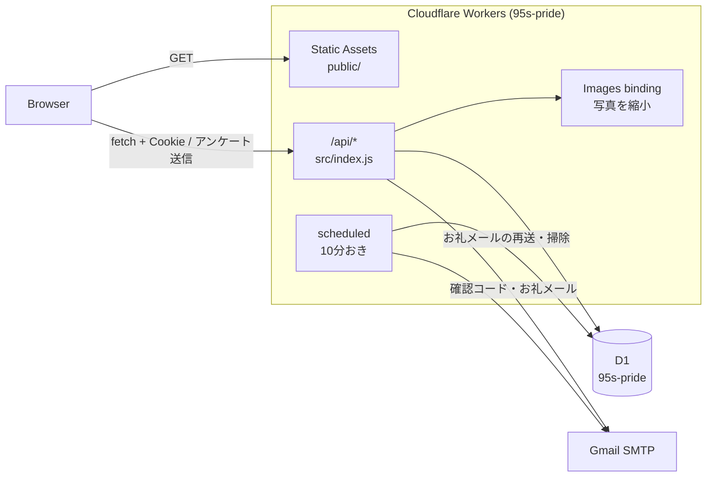
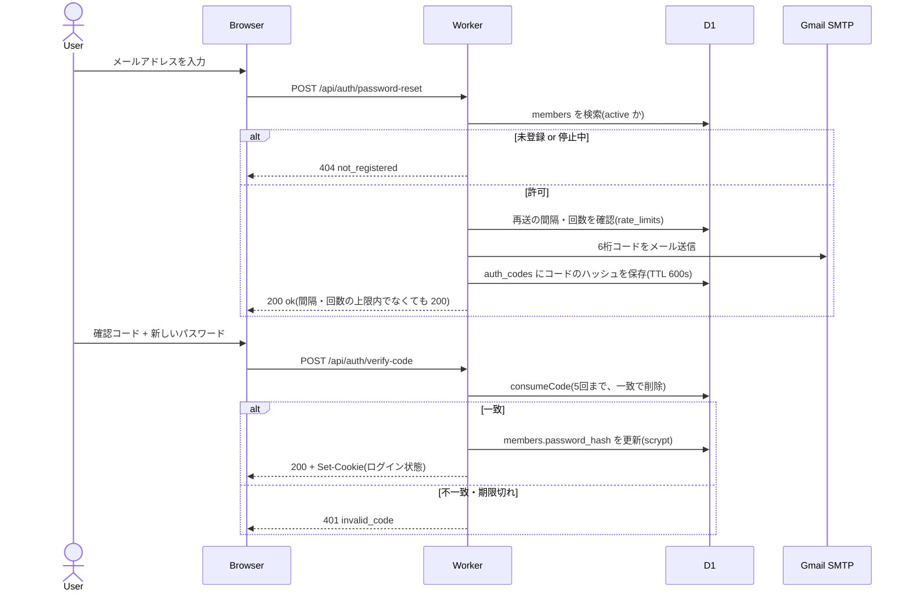

# Architecture(エンジニア向け)

1995年生まれのコミュニティ「95s PRIDE」の公式サイトと、会員制メンバーページ。
プログラミングを知らない人向けの説明は [非エンジニア向け.md](非エンジニア向け.md)。

2026年11月に、Vercel + Google Apps Script(GAS)+ スプレッドシート構成から、Cloudflare Workers + D1 へ移行した。
その後、Google フォームもやめ、アンケートをサイト内の自前フォーム(`/survey`)に置き換えた(Google フォームの写真アップロード欄が、回答者に Google ログインを強いるため)。
移行の経緯と切り替えの記録は [cloudflare/cutover/CUTOVER.md](../cloudflare/cutover/CUTOVER.md)。

## 概要

| 項目 | 内容 |
|---|---|
| 構成 | Cloudflare Workers(サイト配信 + API + 定期実行)+ D1。アプリはひとつのデプロイ単位 |
| フロント | HTML / CSS / 素のJS(ES5)。フレームワーク、ビルド工程なし |
| API | Workers(ES Modules)。`cloudflare/src/` |
| データストア | D1(SQLite)。会員、プロフィール、設問の定義、公開範囲、確認コード、回数制限、写真 |
| 回答の入口 | 自前のアンケート `/survey`(メール確認コード付き)。Worker が検証して D1 に直接保存する。写真もここで縮めて保存。旧 Google フォームは受付を終了し、回答の記録は旧スプレッドシートに残る |
| メール | Gmail SMTP(`smtp.gmail.com:465`)を `worker-mailer` で送る |
| 認証 | メール + パスワード(scrypt)。初回設定・再設定はメールの確認コードで本人確認 |
| セッション | HMAC署名Cookie(30日、ステートレス)。ただし会員限定データを返すたびに D1 で認可を再確認する |
| 公開 | `main` への push で GitHub Actions がテストし、合格したら自動で公開 |
| 本番 | https://95s-pride.inquiry-router.workers.dev |

設計の要点:

- 人は固定ID(`members.id`、`profiles.slug`)で識別する。表示順や行番号に依存しない
- 公開範囲は `profiles.visibility`(`public` / `members` / `hidden`)で明示する。シートの行番号では決めない
- プロフィールに出す設問は `questions.is_public` で明示する。設問を足すときは、公開にするかを migration で決める
- アンケートの設問は、画面のコードではなく D1 の `questions` が持つ(種類・必須・説明・選択肢・見出し)。回答ページは `/api/survey/questions` から組み立てる
- 公開APIは、公開してよい設問だけを返す。メールアドレスは含まない
- 認可の正は D1。運営は管理画面(`/admin`)で公開範囲・停止・紹介カードを変える
- 「会員になれる人」= プロフィールアンケート(`/survey`)の回答者。メールアドレスを確認コードで本人確認してから回答する

## システム構成



旧サイト(`95s-pride.vercel.app`)は、「新サイトはこちら」の案内ページだけを出している(`cloudflare/cutover/old-site-notice.html`)。旧APIは公開していない。

## ディレクトリ

```
.
├─ index.html / members.html / profile.html / survey.html   各ページ(お知らせ等の内容はHTMLに直書き)
├─ css/style.css            全ページ共通
├─ js/
│  ├─ main.js               ローディング演出、ヘッダー、ナビ、スクロール演出
│  ├─ members.js            ログインUI、紹介カードの描画
│  ├─ survey.js             アンケート(メール確認 → 回答 → 送信、下部の進捗バー)
│  └─ profiles.js           プロフィール一覧・詳細の描画(固定ID ?id=。旧 ?no= ?m= も読める)
├─ assets/                  画像。メンバー写真は assets/members/
├─ cloudflare/              Cloudflare 版の本体
│  ├─ wrangler.jsonc        Worker・D1・定期実行・秘密でない設定
│  ├─ src/
│  │  ├─ index.js           入口。/api/* の振り分け、/assets/* の1年キャッシュ、scheduled
│  │  ├─ routes/            auth.js / profiles.js / survey.js / admin.js / photos.js / http.js
│  │  └─ lib/               credentials / session / db / profiles / mail / survey / survey-ticket / sns-links / thanks-retry / photos / dates
│  ├─ migrations/           D1 のスキーマ
│  ├─ site-extra/           Cloudflare 版だけのページ(運営管理画面 admin.html)
│  ├─ scripts/              build-public.mjs、パスワードのハッシュ移行用(旧GAS用)
│  ├─ test/                 Workers 実行環境上のテスト(vitest)
│  └─ cutover/              切り替えの手順書・告知文・旧サイトの案内ページ
├─ .github/workflows/       テストと自動公開
├─ api/  gas/               【旧構成】Vercel Functions と GAS のソース。もう動いていない(記録用)
├─ vercel.json              旧サイトを案内ページにする設定(.vercelignore で api/ gas/ tools/ を外している)
├─ tools/logo/              ロゴSVGの生成スクリプト(Python)
└─ アーキテクチャ/           本ドキュメント
```

- 静的ファイルは、リポジトリ直下のサイト本体と `cloudflare/site-extra/` を `scripts/build-public.mjs` が `cloudflare/public/` に集めて配信する。`public/` は生成物で git には入れない
- `/api/*` と `/assets/*` は、先に Worker を通す(`run_worker_first`)。それ以外は静的ファイルをそのまま返す

## 認証フロー

### パスワードの初回設定・再設定

初回登録と再設定は同じ画面・同じAPI。確認コードとパスワードを一緒に受け取り、コードが正しいときだけ保存する。



### ログイン

- `POST /api/auth/login`。`login-attempts:<email>` を数え、10回で15分ロック(`429 too_many_attempts`)
- 未登録・停止中でも同じ scrypt 計算を行い、応答時間で登録の有無が分からないようにする
- 成功したらロックのカウントを消し、署名Cookieを発行する

### 会員限定データの取得

- `GET /api/members` `GET /api/member-profiles` `GET /api/profile/:id`(会員限定の人)
- Cookie の署名と期限を確認し、さらに D1 で会員が `active` かを毎回確認する。停止された人は、Cookie が残っていてもその場で見られなくなる

## API

| メソッド | パス | 認可 | 内容 |
|---|---|---|---|
| POST | `/api/auth/login` | なし | メール + パスワードでログイン |
| POST | `/api/auth/logout` | なし | Cookie を消す |
| POST | `/api/auth/password-reset` | なし | 確認コードを送る |
| POST | `/api/auth/verify-code` | なし | コード照合 + パスワード保存 + ログイン |
| GET | `/api/survey/questions` | なし | アンケートの設問(種類・必須・説明・選択肢・見出し) |
| POST | `/api/survey/send-code` | なし | メールアドレスに確認コードを送る(登録の有無に関わらず) |
| POST | `/api/survey/verify` | なし | コードを照合し、1時間有効の通行証(署名つき)を返す |
| POST | `/api/survey/submit` | 通行証 | 回答(multipart。設問のキー、`photo`)を検証して保存、お礼メール |
| GET | `/api/public-profiles` | なし | 公開プロフィール(5分間 Cloudflare 側で保存) |
| GET | `/api/member-profiles` | 会員 | 会員限定プロフィール |
| GET | `/api/profile/:id` | 公開は不要、会員限定は会員 | 固定IDで1件。非表示・不明は 404 |
| GET | `/api/photo/:slug` | 公開はなし、会員限定は会員 | アンケートで送られた写真(JPEG)。非表示・不明は 404 |
| GET | `/api/members` | 会員 | 紹介カード |
| GET | `/api/admin/overview` | 運営 | 一覧(プロフィール、会員、設問、カード、運営の一覧、操作の記録30件、自分の権限) |
| POST | `/api/admin/profiles/:id` | 運営 | 公開範囲、写真、最新フラグ |
| POST | `/api/admin/members/:id` | 運営 | 停止・再開、メモ |
| POST | `/api/admin/questions/:key` | 運営 | 設問の公開・非公開 |
| POST | `/api/admin/admins` | オーナー | 運営メンバーの招待(会員として登録し、`manager` で追加。案内メールを送る) |
| DELETE | `/api/admin/photos/:memberId` | 運営 | 会員の写真を削除(不適切な写真への対応) |
| DELETE | `/api/admin/admins/:email` | オーナー | 運営メンバーの解除(オーナーと自分自身は不可) |
| POST / DELETE | `/api/admin/cards[/:id]` | 運営 | 紹介カードの追加・更新・削除 |

画面に返すプロフィールの形: `{ id, title, photo, items: [{ label, value }], links: [{ kind, label, url }] }`。`links` は SNS・リンク(X / Instagram / YouTube / TikTok / その他)で、項目の一覧には混ぜず、画面がアイコンのリンクとして出す。生年月日は「1995年9月6日」の形にそろえる。

## データモデル(D1)

| テーブル | 内容 |
|---|---|
| `members` | 会員。メール(一意)、`password_hash`(`scrypt$salt$key`)、`status`(`active` / `suspended`)、メモ |
| `profiles` | プロフィール(回答1件 = 1行)。固定ID `slug`、`member_id`、`display_name`、`birth_date`、`photo_path`、`visibility`、`is_current`、移行元の `sheet_row`(旧フォームの行番号。新しい回答では空) |
| `profile_answers` | 設問ごとの回答(`profile_id`, `question_key`, `answer`) |
| `questions` | 設問の定義。`is_public`(公開してよいか)、`is_title`(カードの見出し)、並び順。アンケート用に `input_type`(`text` / `textarea` / `choice`)、`required`、`help`(回答例)、`options`(選択肢の JSON)、`section`(見出し。空ならアンケートに出さない) |
| `member_cards` | ログイン後に出す紹介カード(旧「メンバー掲載」シート) |
| `admins` | 管理画面に入れる運営。メール、権限 `role`(`owner` = 全操作 + 招待・解除 / `manager` = 招待・解除以外の全操作)、招待した人 `invited_by` |
| `member_photos` | アンケートでアップロードされた写真(会員ごとに1枚)。取り込みのときに 480×480 の JPEG に縮め、base64 で保存。`updated_at` は写真のURLの `?v=` に使う |
| `admin_log` | 運営の操作の記録(日時、だれが、何を、対象、内容) |
| `auth_codes` | 確認コード(ハッシュで保存)、試行回数、期限 |
| `rate_limits` | 回数制限(再送の間隔、送信回数、ログイン失敗回数)。期限つき |
| `form_imports` | お礼メールの送信記録。自前アンケートの回答は `response_key` が「web」で始まる行。`thanks_mail_sent_at` が空なら未送信。旧 Google フォーム時代の行と、写真の取り込み用の列(`photo_*`)は、記録として残している |

- 同じ会員が複数回答したら、最新の回答だけ `is_current = 1`。古い回答は表示しない(データは残る)
- お礼メールを送らない回答は `thanks_mail_sent_at = 'skipped'` として記録する

### 認可ルール

- ログインできる: `members.status = 'active'`。アンケートに回答した人(メールアドレスを確認済み)は、すべて `active` で登録される
- 管理画面に入れる: `admins` に載っている人(かつ `active`)。人の追加・削除・権限の変更は管理画面にはなく、D1 を直接操作する
- `owner` だけができる操作: 運営の招待(`POST /api/admin/admins`)と解除(`DELETE /api/admin/admins/:email`)。`manager` は `403 owner_only`。そのほかの操作は、両方の権限でできる
- オーナーは、`atsusagi111@gmail.com` と `falco9229@gmail.com`(D1 に直接登録)。招待された人は `manager`
- 公式アドレス(`95spride.official@gmail.com`)は `src/lib/admin-policy.js` の `BLOCKED_ADMIN_EMAILS` で除外している。`admins` に入っていても、招待しても、管理APIは `403`
- 運営として登録された人は、管理画面から停止できない(`400 cannot_suspend_admin`)
- 公開範囲: `visibility = 'public'` は誰でも、`'members'` はログイン中の会員、`'hidden'` はどこにも出さない
- 新しいプロフィールは `members`(会員限定)で入る。公開にするには管理画面で切り替える

## アンケート(自前フォーム)

画面は `survey.html` + `js/survey.js`。設問は D1 の `questions`(`section != ''` のもの)から作る。

```
メール入力 → POST /api/survey/send-code → メールに6桁コード
コード入力 → POST /api/survey/verify    → 通行証(HMAC署名、1時間)
回答       → POST /api/survey/submit    → 検証 → 写真を縮小 → D1 に保存 → お礼メール
```

- 確認コードは、会員のパスワード設定用とは別のキー(`survey:<email>`)で `auth_codes` に保存する。ハッシュで保存し、10分で失効、5回まちがえると失効
- 送信の制限(送る前に数える): 同じメールに60秒に1通・6時間に5通、同じ接続元(`cf-connecting-ip`)から1時間に20通。回答の送信は1人1時間10回まで(`429`)。上限を超えても、コード送信は `200` を返す(画面の動きを変えない)
- ログイン停止中の会員は、コードも送らず(`403 not_allowed`)、回答も受け付けない
- 検証(`validateAnswers`): 必須が空、2000文字超、選択肢にない値は `400`(`error` と `field` を返す)。設問にないキーは無視する
- 保存(`saveSurvey`): 会員がなければ作り、同じ会員の古いプロフィールを `is_current = 0` にして、新しいプロフィールを `visibility = 'members'` で作る。名前は「名前」で始まる設問、生年月日は「生年月日」で始まる設問を使う(`dates.js` で日付をそろえる)
- お礼メール: 回答の直後に送り、`form_imports.thanks_mail_sent_at` に記録する。失敗しても回答は保存され、10分おきの定期実行(`thanks-retry.js`)が、2分〜1日前の未送信分を再送する。Q19 が空などで対象外なら `skipped` にする。文面は `mail.js`(相談の希望あり・なしの両方に、メンバーページのリンクを載せる)
- 進捗バー: 画面の下に固定。必須項目の入力済みの数を数えて、バーと「あと◯項目」を出す

### SNS・リンク

設問キー `sns_x` / `sns_instagram` / `sns_youtube` / `sns_tiktok` / `sns_other`(`sns-links.js`)。`@ID` でも URL でも受け取り、`normalizeSnsLink` が安全な URL にそろえて `profile_answers` に保存する。

- そのSNSのドメイン(サブドメイン含む)だけ受け付ける。`sns_other` はどのサイトでもよいが、`http(s)` のみ(`javascript:`・認証情報つきURL・ドットのないホストは拒否)。`http` は `https` に直す。500文字まで
- プロフィールでは、`links` として返し(`https://` 以外は出さない)、`js/profiles.js` が丸いアイコンのリンクにする(新しいタブ、`rel="noopener noreferrer nofollow"`)
- 一覧のカードはカード全体がリンクなので、アイコンは詳細ページだけに出す
- 趣味・活動の自由記述(`q5`)は、SNS欄とは別に残している

## 写真

- アンケートの写真欄(任意)から `photo` として送る。`prepareSurveyPhoto` が、15MBまで受け付け、Cloudflare の Images binding(`wrangler.jsonc` の `images`)で 480×480 の正方形(中央を切り抜き)の JPEG に縮め、300KB以下かと JPEG の先頭の印を確かめて、`member_photos` に保存する。位置情報などのメタデータは残らない。無料で 5,000 件/月まで
- 縮められない写真(画像でない・壊れている)は、回答ごと保存せずに `400 invalid_photo`(15MB超は `photo_too_large`)を返し、写真を替えてやり直してもらう
- 写真なしで送り直したときは、前の写真を引き継ぐ(会員ごとに1枚)。表示は、アンケートの写真 > 運営が設定した `photo_path` > 共通のアイコン(画面側)の順
- 配信(`/api/photo/:slug`)は、`X-Content-Type-Options: nosniff` と `Content-Security-Policy: sandbox` を付ける。公開のプロフィールは `public, max-age=86400`、会員限定は `private, max-age=3600`
- 会員が自分で写真だけを変える画面・APIは、意図的に作っていない(運営の方針)。運営は管理画面から写真を削除できる

## メール

- 確認コード(会員のパスワード設定用とアンケート用)、お礼メール(回答直後。失敗したら定期実行で再送)、運営の招待の3種類。文面は `src/lib/mail.js`
- 差出人は `MAIL_FROM`(95spride.official@gmail.com)。Gmail 側で「他のメールアドレスを追加(Send mail as)」に登録済みであること
- `MAIL_DRY_RUN=1` のときは送らずログに出す(開発・テスト用)

## セキュリティ

- パスワードは scrypt($salt$key)で保存。平文は保存しない。運営にも見えない
- 確認コードは SHA-256 のハッシュで保存し、10分で失効、5回まちがえると失効
- 確認コードの送信は、60秒の間隔と、6時間5回の上限がある。送る前に回数を数えるので、同時に何件来ても1通しか送られない
- ログイン失敗は10回で15分ロック(メール単位)。回数は、1回の命令で数える(`INSERT ... ON CONFLICT ... RETURNING`)ので、同時に大量の試行が来ても、上限を超えて照合されない
- 確認コードは、照合の前に試行回数を増やす(`UPDATE ... WHERE attempts < 5 RETURNING`)ので、同時に推測されても5回までしか試せない
- Cookie は `HttpOnly; Secure; SameSite=Lax`、HMAC-SHA256 で署名、30日
- 一覧の取得は、会員の数だけ `?` を並べず、結合で絞る(D1 は1回の問い合わせに渡せる値が100個まで)
- 公開APIは、`questions.is_public = 1` の設問だけを返す。メールアドレスは返さない(テストで確認)
- 管理APIは `admins` に載った有効な会員だけ。`POST` / `DELETE` は `Origin` が自サイトと違えば `403 cross_site`(他サイトからの送信を拒否)。操作はすべて `admin_log` に記録する。写真のパスは `assets/members/` 配下のファイル名に限る。紹介カードの画像・Instagram は `https://` のみ
- 画面側は、取得した内容を `textContent` で表示する(HTMLとして解釈しない)
- 管理画面は `noindex`。メンバーページも検索結果に出さない設定
- 旧サイトの API(`api/`)と GAS との接続情報は、公開から外し、Vercel の環境変数も削除済み

## 設定と秘密

秘密(`wrangler secret put` で Cloudflare に入れる。git には入れない):

| 名前 | 内容 |
|---|---|
| `SESSION_SECRET` | ログイン Cookie の署名用 |
| `GMAIL_USER` | 送信に使う Gmail アカウント |
| `GMAIL_APP_PASSWORD` | そのアカウントのアプリパスワード(2段階認証が必要) |

秘密でない設定(`wrangler.jsonc` の `vars`): `MAIL_SENDER_NAME`、`MAIL_FROM`、`MAIL_REPLY_TO`。

ローカル開発の秘密は `cloudflare/.dev.vars`(git に入れない。ひな形は `.dev.vars.example`)。

GitHub Actions の Secrets: `CLOUDFLARE_API_TOKEN`(Workers と D1 の編集権限)、`CLOUDFLARE_ACCOUNT_ID`。

## デプロイ

- `main` に push すると、`.github/workflows/deploy.yml` が `npm test` → D1 の migrations → `wrangler deploy` の順に実行する。テストが落ちたら公開されない
- 手元から公開するときは `cd cloudflare && npm run deploy`
- スキーマを変えるときは `cloudflare/migrations/` に連番の SQL を足す(push 時に自動で当たる)
- 画像は1年 `immutable` でキャッシュされる。差し替えは、**同名で上書きせず、新しいファイル名**で追加し、管理画面の写真欄を書き換える
- ローカル確認: `cd cloudflare && npm install && npm run migrate:local && npm run dev`(http://localhost:8787)
- 運営の追加は、オーナーが管理画面から招待する。オーナー自体の追加は D1 を直接操作する: `cd cloudflare && npx wrangler d1 execute 95s-pride --remote --command "INSERT INTO admins (email, role) VALUES ('メール', 'owner')"`(その人は、先に会員になっている必要がある)
- オーナーの削除・権限の変更: `DELETE FROM admins WHERE email = 'メール'` / `UPDATE admins SET role = 'owner' WHERE email = 'メール'`

## テスト

`cd cloudflare && npm test`(Workers 実行環境 workerd 上で実行。D1 はテストごとに空にする)。ログイン・ロック・停止・確認コード・公開範囲・情報漏れ・管理API(権限、招待・解除、公式アドレスの除外、他サイトからの操作、記録)・アンケート(確認コード、通行証、検証、保存、連打対策、写真、SNSリンクの検証、お礼メールの再送)・同時アクセスでの上限・会員が多い場合の一覧・写真の配信など、62項目。

## バックアップ

- D1 は Time Travel で過去の状態に戻せる(無料プランは7日間)
- 書き出し: `npx wrangler d1 export 95s-pride --remote --output backup.sql`(個人情報を含むので、保管場所に注意)
- 旧 Google フォームの回答の元データは、旧スプレッドシート(「コミュニティ プロフィール回答一覧」)に残っている。新しい回答は D1 だけにある

## 既知の制約

設計上の割り切り:

- パスワード設定画面では、未登録のメールアドレスに `404 not_registered` を返す(使い勝手を優先し、登録有無の推測を許容している)
- 確認コードの送信が間隔・回数の制限で止まっても `200` を返すため、画面はコード入力に進むがメールは届かない
- 1995年生まれかどうかの確認はない。メールアドレスを確認してアンケートに回答すれば会員になれる
- ログイン試行の制限はメール単位のため、第三者が特定の会員を15分ロックできる。IP単位の制限はない

運用・保守:

- **回答の編集はできない。** 直したいときは、アンケートを新しく送り直してもらう(最新のものが表示される)。送信済みの回答を、本人が編集する画面は今後の改善案
- 見出しが `名前`・`生年月日` で始まる設問を表示名・生年月日に使い、`q1` をカードの見出し、`q19` の選択肢でお礼メールの文面を変える(`mail.js` に文言が直書き)。設問を足す・変えるときは migration を書く
- 管理画面から設問を編集する機能はない(公開・非公開の切り替えのみ)
- 写真は、アンケートでアップロードされたもの(`member_photos`)を優先し、なければ運営が設定した `profiles.photo_path`(`assets/members/` のファイル)、どちらも無ければ画面側が共通のアイコンを出す。管理画面から写真をアップロードする機能はない(削除はできる)
- 会員は、アンケートの回答からだけ作られる。回答していない人を会員にしたいときは、`members` に直接 INSERT する(管理画面にはない)
- scrypt のパスワード照合は、Workers Free の CPU 制限(10ms)を超える(実測 30〜64ms)が、短時間の超過は許容されて動いている。CPU 超過のエラーが出るようになったら、Workers Paid(月5ドル)に上げる
- 旧構成の GAS(ウェブアプリ、スクリプトプロパティの保存済みパスワード)は、Apps Script 側にまだ残っている。バックアップ後に停止・削除する予定
