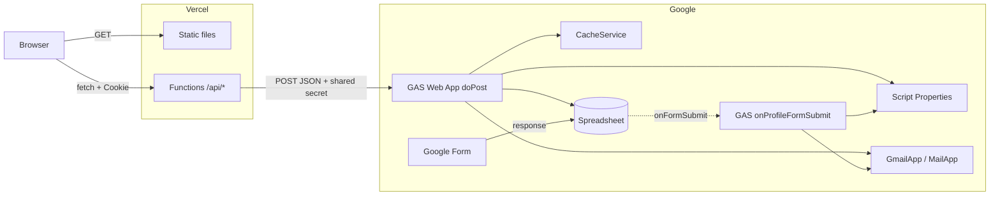
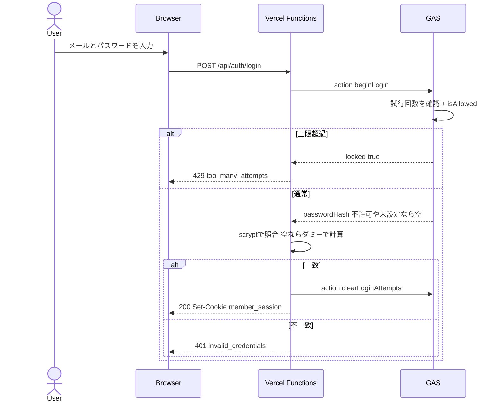
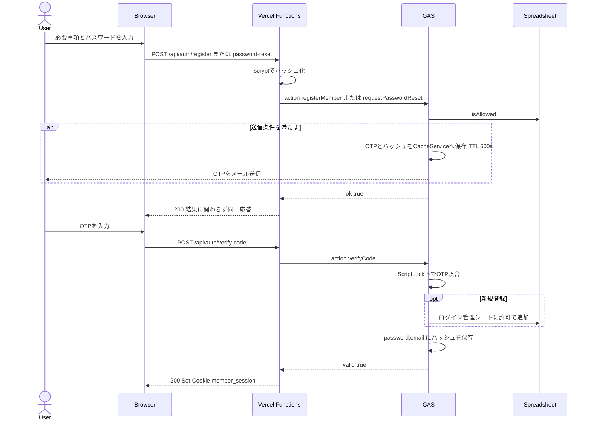

# Architecture(エンジニア向け)

95s PRIDE の公式サイトと、会員制メンバーページ。
2026-11-02 時点のコードに基づく。非エンジニア向けは [非エンジニア向け.md](非エンジニア向け.md)。
同日時点の本番は旧方式(メールOTPのみ)で、パスワード認証は未デプロイ。

## 概要

| 項目 | 内容 |
|---|---|
| 構成 | 静的サイト + サーバーレス関数 + GAS |
| フロント | HTML / CSS / 素のJS。フレームワーク、ビルド工程なし |
| API | Vercel Functions(Node.js / CommonJS)。外部依存なし、`package.json` なし |
| バックエンド | Google Apps Script Web App(`doPost`) |
| データストア | Google スプレッドシート、GAS Script Properties |
| 一時データ | GAS CacheService(OTP、レート制限) |
| 認証 | メール + パスワード(scrypt)。登録と再設定はメールOTPで確認 |
| セッション | HMAC署名Cookie(30日) |
| 本番 | https://95s-pride.vercel.app(Vercel project: `95s-pride`) |

設計の要点は次の4つ。

- ブラウザからGASとスプレッドシートには直接アクセスさせず、必ず `/api/*` を経由する
- パスワードのハッシュ化と照合はVercel側で行い、GASにはハッシュだけを保存する
- セッションはステートレス(Cookieのみ)。代わりに閲覧のたびにGASで認可を再確認する
- 認可の正はスプレッドシート。非エンジニアが表計算の画面で運用できる

## システム構成



## 認証シーケンス

### ログイン



### 新規登録・パスワード再設定

OTPの照合が済むまで、会員登録もパスワード変更も確定しない。



`GET /api/members` は Cookie を検証したうえで `listMembers` を呼び、GASが `isAllowed` を再確認してから `メンバー掲載` シートの内容を返す。

## ディレクトリ

```
.
├─ index.html              トップページ(内容はベタ書き)
├─ members.html            メンバーページの枠。データは持たない
├─ css/style.css           全ページ共通
├─ js/main.js              ローダー、ヘッダー、ナビ、スクロール演出
├─ js/members.js           ログインUI、メンバーカード描画
├─ api/
│  ├─ auth/login.js
│  ├─ auth/register.js
│  ├─ auth/password-reset.js
│  ├─ auth/verify-code.js
│  ├─ auth/logout.js
│  ├─ members.js
│  └─ _lib/                gas.js, password.js, session.js
├─ gas/                    GASソースの控え。Vercelにはデプロイしない
├─ assets/                 画像。1年 immutable キャッシュ
│  └─ src/                 ロゴ生成、画面確認のPython。Vercelにはデプロイしない
├─ vercel.json             cleanUrls、assets のキャッシュヘッダー
└─ アーキテクチャ/          本ドキュメント。Vercelにはデプロイしない
```

`api/_lib/` は `_` で始まるため、Vercelのエンドポイントにはならない。

## API

メソッド不一致は全エンドポイント共通で `405 method_not_allowed`。GAS障害時は `503 unavailable`。

| Method | Path | 入力 | 成功 | 失敗 |
|---|---|---|---|---|
| POST | `/api/auth/login` | `email`, `password` | `200 {ok}` + Set-Cookie | `401 invalid_credentials` / `429 too_many_attempts` |
| POST | `/api/auth/register` | `name`, `email`, `password` | `200 {ok}` | `400 invalid_name`・`invalid_email`・`invalid_password` |
| POST | `/api/auth/password-reset` | `email`, `password` | `200 {ok}` | `400 invalid_email`・`invalid_password` |
| POST | `/api/auth/verify-code` | `email`, `code` | `200 {ok}` + Set-Cookie | `400`・`401 invalid_code` |
| POST | `/api/auth/logout` | なし | `200 {ok}` + Cookie削除 | なし |
| GET | `/api/members` | Cookie | `200 {members}`(`no-store`) | `401 unauthorized` |

`members` の要素は `{ name, title, bio, image, instagram }`。パスワードは8〜128文字、名前は50文字まで。

### GAS `doPost`

リクエストは `{ secret, action, email, ...params }`。`secret` が `MEMBER_API_SECRET` と不一致なら拒否する。

| action | 追加パラメータ | 戻り値 |
|---|---|---|
| `beginLogin` | なし | `{ locked }` または `{ passwordHash }` |
| `clearLoginAttempts` | なし | `{ ok }` |
| `registerMember` | `name`, `ip`, `passwordHash` | `{ ok: true }`(常に同じ) |
| `requestPasswordReset` | `passwordHash` | `{ ok: true }`(常に同じ) |
| `verifyCode` | `code` | `{ valid }` |
| `listMembers` | なし | `{ allowed, members? }` |

エラーは JSON の `error` で返す(`unauthorized` / `unknown_action` / `server_error`)。`api/_lib/gas.js` はこれを例外に変換し、APIは `503` を返す。

## データモデル

### スプレッドシート

| シート | 列 | 用途 |
|---|---|---|
| フォーム回答 | `Email Address` または `メールアドレス` を含む | 既定の認可元。個人情報を含むためAPIに渡さない |
| `ログイン管理` | メールアドレス / 状態(許可/停止)/ メモ | 認可の上書き。新規登録者は `許可` で自動追加 |
| `メンバー掲載` | 名前 / 肩書き / 紹介文 / 画像URL / Instagram URL | 表示データ。回答や登録からの自動転記はない |

### 認可ルール(`isAllowed`)

```
状態 == 停止  → false
状態 == 許可  → true
それ以外      → !REQUIRE_APPROVAL && フォーム回答者である
```

現在は `REQUIRE_APPROVAL = false`。`true` にすると新規登録を止められる。

### 保存データ

| キー | 保存先 | 期限 | 内容 |
|---|---|---|---|
| `password:{email}` | Script Properties | なし | `scrypt$salt$hash` |
| `sent:{email}:{choice}` | Script Properties | なし | お礼メールの送信済み記録 |
| `login-code:{email}` | CacheService | 10分 | `{ code, name, passwordHash, attempts }` |
| `login-cooldown:{email}` | CacheService | 60秒 | 再送待ち |
| `login-count:{email}` | CacheService | 6時間 | 送信回数(上限5) |
| `login-attempts:{email}` | CacheService | 15分 | ログイン試行回数(上限10) |
| `register-ip:{ip}` | CacheService | 1時間 | 新規登録の回数(上限5) |
| `member_session` | Cookie | 30日 | `base64url(JSON{email,expiresAt}).HMAC-SHA256` |

Cookie属性は `HttpOnly; Secure; SameSite=Lax; Path=/`。

## セキュリティ

| 脅威 | 対策 | 実装 |
|---|---|---|
| パスワード漏えい | saltつき scrypt でハッシュ化。平文は保存しない | `password.js` |
| アカウント列挙 | 同一応答。未登録でもダミーハッシュで計算し応答時間を揃える | `password.js`, `gas/member-login.gs` |
| パスワード総当たり | メール単位で10回まで。超えたら15分ロック | `beginLogin` |
| OTP総当たり | 1コード5回、TTL 10分、成功で破棄 | `verifyCode` |
| メール爆撃 | 60秒クールダウン、6時間5通 | `sendCode` |
| 大量登録 | IP単位で1時間5回。送信枠が残り30以下なら新規登録分を止める | `registerMember` |
| Cookie改ざん | HMAC-SHA256、`timingSafeEqual` で比較 | `session.js` |
| XSS | `textContent` のみ使用、URLは `https://` 限定 | `js/members.js` |
| 権限剥奪後の閲覧 | `listMembers` が毎回 `isAllowed` を確認 | `api/members.js` |
| GAS直叩き | 共有シークレットを照合 | `doPost` |

## 環境変数

| 変数 | 場所 | 用途 |
|---|---|---|
| `GAS_WEBAPP_URL` | Vercel | GAS Web App のURL |
| `GAS_SHARED_SECRET` | Vercel | `MEMBER_API_SECRET` と同じ値 |
| `SESSION_SECRET` | Vercel | Cookie署名鍵 |
| `MEMBER_API_SECRET` | GAS Script Properties | 共有シークレット |
| `MEMBER_SPREADSHEET_ID` | GAS Script Properties | `setupMemberLogin` が設定 |

ローカルの値は `.env.local`(Git管理外)にある。`SESSION_SECRET` を変更すると全セッションが無効になる。

## デプロイ

サイトとGASは別々に反映する。**GitHubへのpushではどちらもデプロイされない。**

| 対象 | 手順 |
|---|---|
| サイト / API | リポジトリ直下で `vercel --prod`。除外対象は `.vercelignore` |
| GAS | エディタへ手動で反映し、`doPost` 系を変えたらWebアプリを新バージョンでデプロイ |

APIとGASのaction名は対応している。片方だけ更新するとログインが動かなくなるので、両方を同時に反映する。

`member-login.gs` は単体で動く。初回セットアップでは `setupMemberLogin()` と、お礼メール用の `setupTrigger()` を各1回実行する。

## 既知の制約

- `REQUIRE_APPROVAL = false` のため、メールを確認できれば誰でも会員登録できる。1995年生まれかどうかの確認はない
- テスト、CI、lint はない
- ログイン試行の制限はメール単位のため、第三者が特定の会員を15分ロックできる
- ログインと登録以外のエンドポイントにIP単位の制限はない
- CacheService は期限前に消える場合があるため、レート制限は厳密ではない
- `sendCode` はロックを取らないため、同時リクエストでクールダウンをすり抜ける余地がある
- `login-count` はput時にTTLが更新されるため、最後の送信から6時間のスライディングウィンドウとして動く
- Script Properties には総容量の上限があり、会員数に応じて `password:*` が増える
- フォーム回答者にはパスワードが未設定のため、初回は新規登録か再設定が必要
- `/api/members` は毎回シートを読む。キャッシュがなく、応答はGASの実行速度に依存する
- メール送信は Google の1日あたりの上限に依存する
- シート名、メール列の見出し、`Q19`・`Q2 ` で始まる設問見出し、Q19の選択肢の文言をコードが直接参照している
- `index.html` のお知らせのコメントにある `data-category` は古い。ラベルは `.news-card__cat` の文字で決まる
- 参照されていない画像が直下と `assets/news-event.png` にある(`.vercelignore` 未指定のものは公開される)
