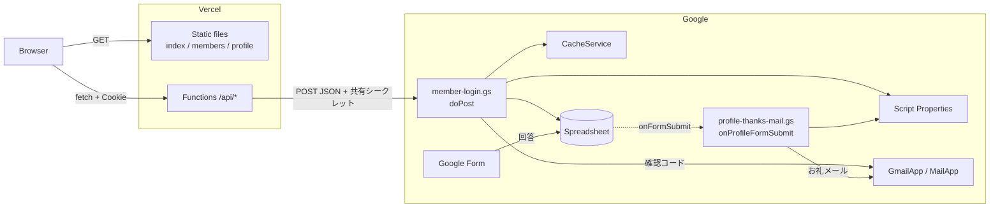
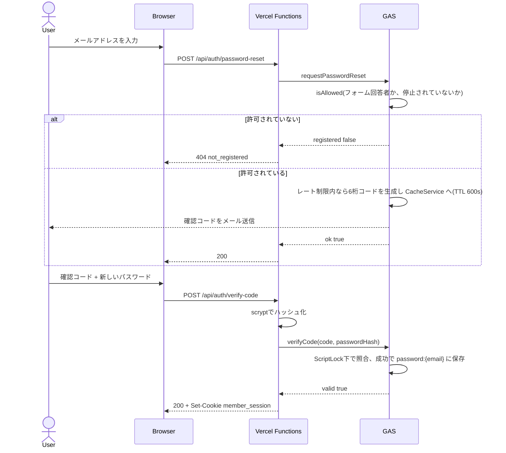
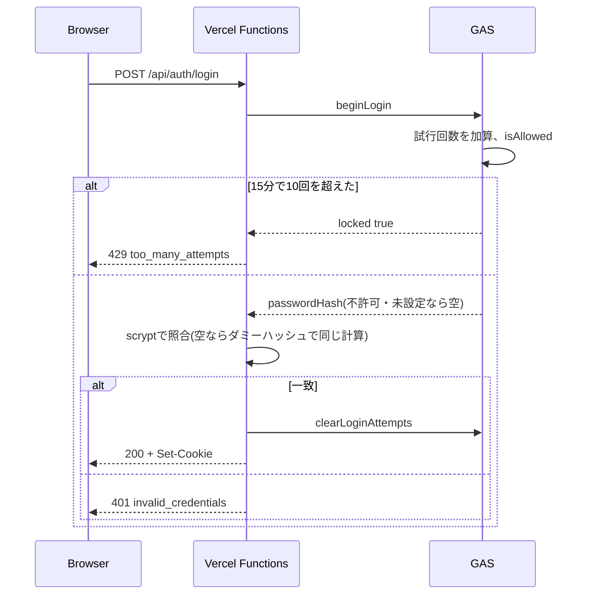

# Architecture(エンジニア向け)

1995年生まれのコミュニティ「95s PRIDE」の公式サイトと、会員制メンバーページ。
プログラミング初心者向けの説明は [非エンジニア向け.md](非エンジニア向け.md)。

## 概要

| 項目 | 内容 |
|---|---|
| 構成 | 静的サイト + Vercel Functions + Google Apps Script(GAS) |
| フロント | HTML / CSS / 素のJS(ES5)。フレームワーク、ビルド工程なし |
| API | Vercel Functions(Node.js / CommonJS)。外部依存なし、`package.json` なし |
| バックエンド | GAS Web App(`doPost`)。スプレッドシートに紐づくスクリプト |
| データストア | Google スプレッドシート、GAS Script Properties |
| 一時データ | GAS CacheService(確認コード、レート制限) |
| 認証 | メール + パスワード(scrypt)。パスワードの初回設定・再設定はメールの確認コードで本人確認 |
| セッション | HMAC署名Cookie(30日、ステートレス) |
| 本番 | https://95s-pride.vercel.app |

設計の要点:

- ブラウザからGASとスプレッドシートには直接アクセスさせず、必ず `/api/*` を経由する
- パスワードのハッシュ化と照合はVercel側で行い、GASにはハッシュだけを渡して保存する
- セッションはCookieのみ。その代わり、会員限定データを返すたびにGASで認可を再確認する
- 認可の正はスプレッドシート。運営(非エンジニア)が表計算の画面で許可・停止できる
- 「会員になれる人」= プロフィールアンケート(Googleフォーム)の回答者

## システム構成



## ディレクトリ

```
.
├─ index.html              トップページ(お知らせ等の内容はHTMLに直書き)
├─ members.html            メンバー一覧(公開プロフィール + ログイン後の会員限定)
├─ profile.html            プロフィール詳細(?no=N 公開 / ?m=N 会員限定)
├─ css/style.css           全ページ共通
├─ js/
│  ├─ main.js              ローディング演出、ヘッダー、ナビ、スクロール演出(全ページ)
│  ├─ members.js           ログインUI、「メンバー掲載」カードの描画
│  └─ profiles.js          プロフィール一覧・詳細の描画、写真の対応表
├─ api/
│  ├─ auth/                login / logout / password-reset / verify-code
│  ├─ members.js           会員限定:「メンバー掲載」シート
│  ├─ member-profiles.js   会員限定:非公開のプロフィール
│  ├─ public-profiles.js   公開プロフィール
│  └─ _lib/
│     ├─ handler.js        メソッド確認・例外→503、会員確認(fetchForMember)
│     ├─ gas.js            GAS呼び出し
│     ├─ credentials.js    メール正規化、パスワード検証・scrypt
│     └─ session.js        署名Cookieの発行・検証・削除
├─ gas/                    GASソースの控え(手動でエディタに貼る)
├─ assets/                 画像。メンバー写真は assets/members/
├─ tools/logo/             ロゴSVGの生成スクリプト(Python)
├─ vercel.json             cleanUrls、assets の1年キャッシュ
└─ アーキテクチャ/          本ドキュメント
```

- `api/_lib/` は `_` で始まるため、Vercelのエンドポイントにならない
- `gas/` `tools/` `アーキテクチャ/` `README.md` は `.vercelignore` で公開対象から外している

## 認証フロー

### パスワードの初回設定・再設定

初回登録と再設定は同じ画面・同じAPI。確認コードとパスワードを一緒に受け取り、コードが正しいときだけ保存する。



### ログイン



### 会員限定データの取得

`/api/members` と `/api/member-profiles` は `fetchForMember`(`api/_lib/handler.js`)を通る。
Cookieを検証 → GASが毎回 `isAllowed` を確認 → 不許可ならCookieを削除して401。
「停止」にした人は、Cookieの期限内でも次のリクエストから見られなくなる。

## API

全エンドポイント共通: メソッド不一致は `405 method_not_allowed`、GAS障害などの例外は `503 unavailable`。

| Method | Path | 入力 | 成功 | 失敗 |
|---|---|---|---|---|
| POST | `/api/auth/login` | `email`, `password` | `200 {ok}` + Set-Cookie | `401 invalid_credentials` / `429 too_many_attempts` |
| POST | `/api/auth/password-reset` | `email` | `200 {ok}` | `400 invalid_email` / `404 not_registered` |
| POST | `/api/auth/verify-code` | `email`, `code`, `password` | `200 {ok}` + Set-Cookie | `400 invalid_code`・`invalid_password` / `401 invalid_code` |
| POST | `/api/auth/logout` | なし | `200 {ok}` + Cookie削除 | なし |
| GET | `/api/members` | Cookie | `200 {members}` | `401 unauthorized` |
| GET | `/api/member-profiles` | Cookie | `200 {profiles}` | `401 unauthorized` |
| GET | `/api/public-profiles` | なし | `200 {profiles}` | なし |

- `members[]`: `{ name, title, bio, image, instagram }`
- `profiles[]`: `{ title, items: [{ label, value }] }`
- キャッシュ: 会員限定は `no-store`。公開プロフィールは `s-maxage=300`(Vercelのエッジだけで5分)
- パスワードは8〜128文字。確認コードは数字6桁

### GAS `doPost`

リクエストは `{ secret, action, email?, code?, passwordHash? }`。`secret` が Script Properties の `MEMBER_API_SECRET` と一致しなければ `{ error: 'unauthorized' }`。

| action | 戻り値 |
|---|---|
| `beginLogin` | `{ locked: true }` または `{ passwordHash }` |
| `clearLoginAttempts` | `{ ok }` |
| `requestPasswordReset` | `{ ok: true }` または `{ ok: false, registered: false }` |
| `verifyCode` | `{ valid }` |
| `listMembers` | `{ allowed, members? }` |
| `memberProfiles` | `{ allowed, profiles? }` |
| `publicProfiles` | `{ profiles }` |

エラーは `{ error }`(`unauthorized` / `unknown_action` / `server_error`)。`api/_lib/gas.js` がこれを例外にし、APIは503を返す。

## データモデル

### スプレッドシート

| シート | 列 | 用途 |
|---|---|---|
| フォームの回答シート | `Email Address` / `メールアドレス` の列を含む | 会員資格の判定元。プロフィールの元データ |
| `ログイン管理` | メールアドレス / 状態(許可・停止)/ メモ | 認可の上書き |
| `メンバー掲載` | 名前 / 肩書き / 紹介文 / 画像URL / Instagram URL | ログイン後に出すカード。手入力 |

### 認可ルール(`isAllowed`)

```
状態 == 停止  → false
状態 == 許可  → true
それ以外      → !REQUIRE_APPROVAL && フォーム回答者である
```

現在は `REQUIRE_APPROVAL = false`(フォーム回答者は自動で会員)。

### プロフィールの公開範囲

回答シートから、次の条件で `{ title, items }` を作る(`buildProfiles`)。

| 設定(`gas/member-login.gs`) | 意味 |
|---|---|
| `PUBLIC_ROWS` | ログインなしで公開する行番号。それ以外の回答行は会員限定 |
| `PUBLIC_FIRST_COLUMN` 〜 `PUBLIC_LAST_COLUMN` | 対象の列範囲(B〜S) |
| `PUBLIC_EXCLUDE_KEYWORDS` | 見出しにこれらを含む列は出さない(メール、電話、住所、本名など) |
| `PUBLIC_TITLE_PREFIX` | この文字で始まる列(`Q1 `)をカードの見出しにする |

- 日付のセルは `getValues()` の `Date` から `yyyy年M月d日` に整形する(シートの地域設定に依存しない)
- 公開される列はGASエディタで `previewPublicProfiles()` を実行すると確認できる
- 写真は回答に含まれない。`js/profiles.js` の `PROFILE_IMAGES` で「名前の回答 → `assets/members/` の画像」を対応づけ、無い人は共通画像

### 保存データ

| キー | 保存先 | 期限 | 内容 |
|---|---|---|---|
| `password:{email}` | Script Properties | なし | `scrypt$salt$hash` |
| `sent:{email}:{choice}` | Script Properties | なし | お礼メールの送信済み記録 |
| `login-code:{email}` | CacheService | 10分 | `{ code, attempts }` |
| `login-cooldown:{email}` | CacheService | 60秒 | 再送待ち |
| `login-count:{email}` | CacheService | 6時間 | 確認コードの送信回数(上限5) |
| `login-attempts:{email}` | CacheService | 15分 | ログイン試行回数(上限10) |
| `member_session` | Cookie | 30日 | `base64url(JSON{email,expiresAt}).HMAC-SHA256` |

Cookie属性は `HttpOnly; Secure; SameSite=Lax; Path=/`。

## セキュリティ

| 脅威 | 対策 | 実装 |
|---|---|---|
| パスワード漏えい | salt付き scrypt。平文は保存もログ出力もしない | `api/_lib/credentials.js` |
| ログイン時の登録有無の推測 | 未登録・不一致は同じ401。未登録でもダミーハッシュで計算し応答時間を揃える | `credentials.js`, `beginLogin` |
| パスワード総当たり | メール単位で15分10回まで | `beginLogin` |
| 確認コード総当たり | 1コード5回まで、TTL 10分、成功で破棄 | `verifyCode` |
| メール爆撃 | 60秒クールダウン、6時間で5通 | `sendCode` |
| Cookie改ざん | HMAC-SHA256、`timingSafeEqual` で比較 | `api/_lib/session.js` |
| XSS | シートの値は `textContent` でのみ描画。リンク・画像は `https://` に限定 | `js/members.js`, `js/profiles.js` |
| 権限剥奪後の閲覧 | 会員限定APIのたびに `isAllowed` を再確認 | `fetchForMember` |
| GAS直叩き | 共有シークレットを照合 | `doPost` |
| 個人情報の公開 | 公開行・列をGAS側で絞り、連絡先系の列は見出しで除外 | `buildProfiles` |
| なりすましメール | 認証メールは公式アドレスのエイリアスから送り、未設定なら送信しない | `sendAuthMail` |

## 環境変数

| 変数 | 場所 | 用途 |
|---|---|---|
| `GAS_WEBAPP_URL` | Vercel | GAS Web App のURL |
| `GAS_SHARED_SECRET` | Vercel | `MEMBER_API_SECRET` と同じ値 |
| `SESSION_SECRET` | Vercel | Cookie署名鍵。変更すると全セッションが無効になる |
| `MEMBER_API_SECRET` | GAS Script Properties | 共有シークレット |
| `MEMBER_SPREADSHEET_ID` | GAS Script Properties | `setupMemberLogin()` が設定 |

ローカルの値は `.env.local`(Git管理外)。

## デプロイ

サイトとGASは別々に反映する。**GitHubへのpushではどちらも自動デプロイされない。**

| 対象 | 手順 |
|---|---|
| サイト / API | リポジトリ直下で `vercel --prod` |
| GAS | 回答スプレッドシートの「拡張機能 → Apps Script」に `gas/*.gs` を貼り、「デプロイを管理 → 編集 → 新バージョン」。URLは変わらない |

- 「新しいデプロイ」を作るとURLが変わるため、Vercelの `GAS_WEBAPP_URL` も更新して再デプロイが必要
- APIとGASのaction名は対応している。互換性のない変更はGASを先に反映する
- 初回セットアップ: `setupMemberLogin()`(管理シートとスプレッドシートIDの準備)と `setupTrigger()`(お礼メールのトリガー登録)を各1回実行
- `assets/` は1年 `immutable` でキャッシュされる。画像の差し替えは必ず新しいファイル名で行う

## 既知の制約

設計上の割り切り:

- パスワード設定画面では、未登録のメールアドレスに `404 not_registered` を返す(使い勝手を優先し、登録有無の推測を許容している)
- 確認コードの送信がレート制限で止まっても `200` を返すため、画面はコード入力に進むがメールは届かない
- 1995年生まれかどうかの確認はない。フォームに回答すれば会員になれる
- ログイン試行の制限はメール単位のため、第三者が特定の会員を15分ロックできる。IP単位の制限はない

運用・保守:

- テスト、CI、lint はない
- GASはclasp未導入。`gas/` はエディタへ手動で貼る控えで、本番と一致している保証はない
- `PUBLIC_ROWS` は行番号指定。回答シートを並べ替えたり行を挿入したりすると公開対象がずれる
- プロフィール詳細のURL(`?no=N` / `?m=N`)は一覧の順番。行が増減すると同じURLが別の人を指す
- `メンバー掲載` シートの「サンプル」という名前の行はコードで除外している
- シート名、メール列の見出し、`Q1 `・`Q2 `・`Q19` で始まる設問見出し、Q19の選択肢の文言をコードが直接参照している
- 2つの `.gs` ファイルは同じGASプロジェクトのグローバルスコープを共有する
- 会員限定APIは毎回シートを読む(キャッシュなし)。応答はGASの実行速度(1〜数秒)に依存する
- CacheService は期限前に消えることがあり、レート制限は厳密ではない。`sendCode` はロックを取らない
- Script Properties には総容量の上限があり、会員数に応じて `password:*` が増える
- メール送信数は Google の1日あたりの上限に依存する
