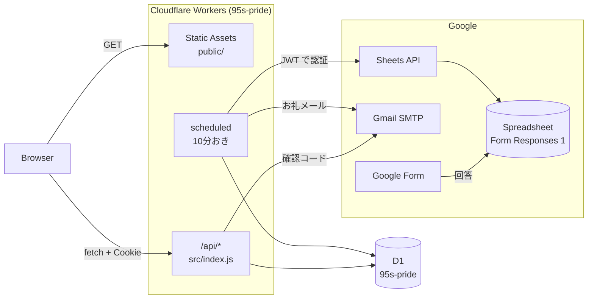
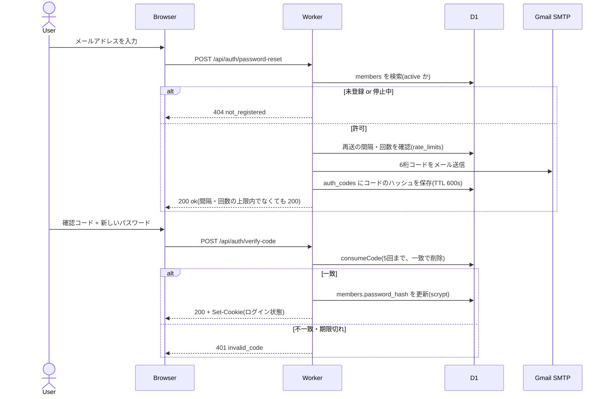

# Architecture(エンジニア向け)

1995年生まれのコミュニティ「95s PRIDE」の公式サイトと、会員制メンバーページ。
プログラミングを知らない人向けの説明は [非エンジニア向け.md](非エンジニア向け.md)。

2026年11月に、Vercel + Google Apps Script(GAS)+ スプレッドシート構成から、Cloudflare Workers + D1 へ移行した。
移行の経緯と切り替えの記録は [cloudflare/cutover/CUTOVER.md](../cloudflare/cutover/CUTOVER.md)。

## 概要

| 項目 | 内容 |
|---|---|
| 構成 | Cloudflare Workers(サイト配信 + API + 定期実行)+ D1。アプリはひとつのデプロイ単位 |
| フロント | HTML / CSS / 素のJS(ES5)。フレームワーク、ビルド工程なし |
| API | Workers(ES Modules)。`cloudflare/src/` |
| データストア | D1(SQLite)。会員、プロフィール、公開範囲、確認コード、回数制限、取り込み記録 |
| 回答の入口 | Google フォーム → スプレッドシート。Worker が10分おきに Sheets API で読み、D1 へ取り込む |
| メール | Gmail SMTP(`smtp.gmail.com:465`)を `worker-mailer` で送る |
| 認証 | メール + パスワード(scrypt)。初回設定・再設定はメールの確認コードで本人確認 |
| セッション | HMAC署名Cookie(30日、ステートレス)。ただし会員限定データを返すたびに D1 で認可を再確認する |
| 公開 | `main` への push で GitHub Actions がテストし、合格したら自動で公開 |
| 本番 | https://95s-pride.inquiry-router.workers.dev |

設計の要点:

- 人は固定ID(`members.id`、`profiles.slug`)で識別する。表示順や行番号に依存しない
- 公開範囲は `profiles.visibility`(`public` / `members` / `hidden`)で明示する。シートの行番号では決めない
- プロフィールに出す設問は `questions.is_public` で明示する。フォームに設問が増えても、公開にするまで出ない(新しい設問は非公開で登録される)
- 公開APIは、公開してよい設問だけを返す。メールアドレスは含まない
- 認可の正は D1。運営は管理画面(`/admin`)で公開範囲・停止・紹介カードを変える
- 「会員になれる人」= プロフィールアンケート(Googleフォーム)の回答者

## システム構成



旧サイト(`95s-pride.vercel.app`)は、「新サイトはこちら」の案内ページだけを出している(`cloudflare/cutover/old-site-notice.html`)。旧APIは公開していない。

## ディレクトリ

```
.
├─ index.html / members.html / profile.html   各ページ(お知らせ等の内容はHTMLに直書き)
├─ css/style.css            全ページ共通
├─ js/
│  ├─ main.js               ローディング演出、ヘッダー、ナビ、スクロール演出
│  ├─ members.js            ログインUI、紹介カードの描画
│  └─ profiles.js           プロフィール一覧・詳細の描画(固定ID ?id=。旧 ?no= ?m= も読める)
├─ assets/                  画像。メンバー写真は assets/members/
├─ cloudflare/              Cloudflare 版の本体
│  ├─ wrangler.jsonc        Worker・D1・定期実行・秘密でない設定
│  ├─ src/
│  │  ├─ index.js           入口。/api/* の振り分け、/assets/* の1年キャッシュ、scheduled
│  │  ├─ routes/            auth.js / profiles.js / admin.js / http.js
│  │  └─ lib/               credentials / session / db / profiles / mail / google-sheets / sync / sheet-rows
│  ├─ migrations/           D1 のスキーマ
│  ├─ site-extra/           Cloudflare 版だけのページ(運営管理画面 admin.html)
│  ├─ scripts/              build-public.mjs、移行用の取り込みスクリプト
│  ├─ test/                 Workers 実行環境上のテスト(vitest)
│  └─ cutover/              切り替えの手順書・告知文・旧サイトの案内ページ
├─ .github/workflows/       テストと自動公開
├─ api/  gas/               【旧構成】Vercel Functions と GAS のソース。もう動いていない(記録用)
├─ vercel.json              旧サイトを案内ページにする設定(.vercelignore で api/ gas/ tools/ を外している)
├─ tools/logo/              ロゴSVGの生成スクリプト(Python)
└─ アーキテクチャ/           本ドキュメント
```

- 静的ファイルは、リポジトリ直下のサイト本体と `cloudflare/site-extra/` を `scripts/build-public.mjs` が `cloudflare/public/` に集めて配信する。`public/` は生成物で git には入れない
- `/api/*` と `/assets/*` は、先に Worker を通す(`run_worker_first`)。それ以外は静的ファイルをそのまま返す

## 認証フロー

### パスワードの初回設定・再設定

初回登録と再設定は同じ画面・同じAPI。確認コードとパスワードを一緒に受け取り、コードが正しいときだけ保存する。



### ログイン

- `POST /api/auth/login`。`login-attempts:<email>` を数え、10回で15分ロック(`429 too_many_attempts`)
- 未登録・停止中でも同じ scrypt 計算を行い、応答時間で登録の有無が分からないようにする
- 成功したらロックのカウントを消し、署名Cookieを発行する

### 会員限定データの取得

- `GET /api/members` `GET /api/member-profiles` `GET /api/profile/:id`(会員限定の人)
- Cookie の署名と期限を確認し、さらに D1 で会員が `active` かを毎回確認する。停止された人は、Cookie が残っていてもその場で見られなくなる

## API

| メソッド | パス | 認可 | 内容 |
|---|---|---|---|
| POST | `/api/auth/login` | なし | メール + パスワードでログイン |
| POST | `/api/auth/logout` | なし | Cookie を消す |
| POST | `/api/auth/password-reset` | なし | 確認コードを送る |
| POST | `/api/auth/verify-code` | なし | コード照合 + パスワード保存 + ログイン |
| GET | `/api/public-profiles` | なし | 公開プロフィール(5分間 Cloudflare 側で保存) |
| GET | `/api/member-profiles` | 会員 | 会員限定プロフィール |
| GET | `/api/profile/:id` | 公開は不要、会員限定は会員 | 固定IDで1件。非表示・不明は 404 |
| GET | `/api/photo/:slug` | 公開はなし、会員限定は会員 | アンケートで送られた写真(JPEG)。非表示・不明は 404 |
| GET | `/api/members` | 会員 | 紹介カード |
| GET | `/api/admin/overview` | 運営 | 一覧(プロフィール、会員、設問、カード、運営の一覧、操作の記録30件、自分の権限) |
| POST | `/api/admin/sync` | 運営 | フォーム回答をいま取り込む |
| POST | `/api/admin/profiles/:id` | 運営 | 公開範囲、写真、最新フラグ |
| POST | `/api/admin/members/:id` | 運営 | 停止・再開、メモ |
| POST | `/api/admin/questions/:key` | 運営 | 設問の公開・非公開 |
| POST | `/api/admin/admins` | オーナー | 運営メンバーの招待(会員として登録し、`manager` で追加。案内メールを送る) |
| DELETE | `/api/admin/photos/:memberId` | 運営 | 会員の写真を削除(不適切な写真への対応) |
| DELETE | `/api/admin/admins/:email` | オーナー | 運営メンバーの解除(オーナーと自分自身は不可) |
| POST / DELETE | `/api/admin/cards[/:id]` | 運営 | 紹介カードの追加・更新・削除 |

画面に返すプロフィールの形: `{ id, title, photo, items: [{ label, value }] }`。生年月日は「1995年9月6日」の形にそろえる。

## データモデル(D1)

| テーブル | 内容 |
|---|---|
| `members` | 会員。メール(一意)、`password_hash`(`scrypt$salt$key`)、`status`(`active` / `suspended`)、メモ |
| `profiles` | プロフィール(回答1件 = 1行)。固定ID `slug`、`member_id`、`display_name`、`birth_date`、`photo_path`、`visibility`、`is_current`、移行元の `sheet_row` |
| `profile_answers` | 設問ごとの回答(`profile_id`, `question_key`, `answer`) |
| `questions` | 設問の定義。`is_public`(公開してよいか)、`is_title`(カードの見出し)、並び順 |
| `member_cards` | ログイン後に出す紹介カード(旧「メンバー掲載」シート) |
| `admins` | 管理画面に入れる運営。メール、権限 `role`(`owner` = 全操作 + 招待・解除 / `manager` = 招待・解除以外の全操作)、招待した人 `invited_by` |
| `member_photos` | アンケートでアップロードされた写真(会員ごとに1枚)。取り込みのときに 480×480 の JPEG に縮め、base64 で保存。`updated_at` は写真のURLの `?v=` に使う |
| `admin_log` | 運営の操作の記録(日時、だれが、何を、対象、内容) |
| `auth_codes` | 確認コード(ハッシュで保存)、試行回数、期限 |
| `rate_limits` | 回数制限(再送の間隔、送信回数、ログイン失敗回数)。期限つき |
| `form_imports` | フォーム回答の取り込み記録。`response_key`(`回答日時|メール`)、お礼メールの送信日時、写真の取り込みの状態(`photo_file_id` / `photo_state` / `photo_attempts`) |

- 同じ会員が複数回答したら、最新の回答だけ `is_current = 1`。古い回答は表示しない(データは残る)
- お礼メールを送らない回答は `thanks_mail_sent_at = 'skipped'` として記録する

### 認可ルール

- ログインできる: `members.status = 'active'`。フォームに回答してメールアドレスが取り込まれた人はすべて `active` になる
- 管理画面に入れる: `admins` に載っている人(かつ `active`)。人の追加・削除・権限の変更は管理画面にはなく、D1 を直接操作する
- `owner` だけができる操作: 運営の招待(`POST /api/admin/admins`)と解除(`DELETE /api/admin/admins/:email`)。`manager` は `403 owner_only`。そのほかの操作は、両方の権限でできる
- オーナーは、`atsusagi111@gmail.com` と `falco9229@gmail.com`(D1 に直接登録)。招待された人は `manager`
- 公式アドレス(`95spride.official@gmail.com`)は `src/lib/admin-policy.js` の `BLOCKED_ADMIN_EMAILS` で除外している。`admins` に入っていても、招待しても、管理APIは `403`
- 運営として登録された人は、管理画面から停止できない(`400 cannot_suspend_admin`)
- 公開範囲: `visibility = 'public'` は誰でも、`'members'` はログイン中の会員、`'hidden'` はどこにも出さない
- 新しいプロフィールは `members`(会員限定)で入る。公開にするには管理画面で切り替える

## フォーム回答の取り込み

`scheduled`(10分おき)と、管理画面の「今すぐ取り込む」から `syncResponses` を呼ぶ。

1. サービスアカウントの JWT で Google のアクセストークンを取り、Sheets API で回答シート(`SHEET_RANGE`)を読む
2. 新しい設問は `questions` に非公開で登録する
3. 各行を `parseResponseRow` で整える。メールアドレスのない行は取り込まない
4. `response_key`(回答日時 + メール)が未取り込みなら、会員(なければ作る)とプロフィールを作り、同じ会員の古いプロフィールを `is_current = 0` にする
5. 写真の設問(見出しが `プロフィール写真` で始まる設問。Q番号の有無は問わない)があれば、回答のドライブのURLからファイルIDを取り出し、`form_imports.photo_state = 'pending'` にする。写真の設問は、`questions` と `profile_answers` には入れない(URLを画面に出さない)
6. `pending` の写真を、1回の実行で3件まで取り込む。サービスアカウント(Drive の読み取り)でファイルを読み、画像変換(`env.IMAGES`)で 480×480 の JPEG に縮め、`member_photos` に保存する。失敗したら次の実行でやり直し(失敗の少ない順)、30回(約5時間)失敗したら `failed` にして、写真なしとして扱う。`failed` を取り込み直したいときは、`UPDATE form_imports SET photo_state = 'pending', photo_attempts = 0 WHERE photo_state = 'failed'` を実行する
7. お礼メールが未送信で、`THANKS_MAIL_SINCE` 以降の回答なら送る(失敗したら次回に再送する)

写真は、回答を送り直して写真が入っていれば差し替わり、入っていなければ前の写真が残る(会員ごとに1枚で、プロフィールが新しくなっても引き継ぐ)。表示は、アンケートの写真 > 運営が設定した `photo_path` > 共通のアイコン(画面側)の順。

日付は `10/5/2026 22:31:33`、`6/11/1995`、`1995年6月29日` の3つの書き方を読める(`sheet-rows.js`)。

## 写真(アンケートのファイルアップロード)

- Google フォームに、見出しが `プロフィール写真(任意)` の「ファイルのアップロード」の設問を、名前(Q2)の次に置く(必須にしない、画像のみ、1ファイル)。Q番号は付けない(付けても読める)。付けないので、途中に足しても、ほかの設問の番号は変わらない。Google の仕様で、ファイルのアップロード欄があるフォームは、回答者の Google ログインが必要になる
- アップロードされたファイルは、フォームの所有者のドライブの「(フォーム名)(File responses)」フォルダに入る。このフォルダを、フォームの所有者が、サービスアカウントに「閲覧者」で共有しておく(以後のファイルも、フォルダの共有を引き継ぐ。所有者でないと共有できない)
- 回答シートの写真の欄には、`https://drive.google.com/open?id=ファイルID` が入る。`extractDriveFileId` がファイルIDを取り出す
- 縮小は Cloudflare の Images binding(`wrangler.jsonc` の `images`)。無料で 5,000 件/月まで(Free プランで使えることを確認済み)。JPEG・PNG・WebP・HEIC などを読め、出力は JPEG のみ。位置情報などのメタデータは残らない
- 配信(`/api/photo/:slug`)は、`X-Content-Type-Options: nosniff` と `Content-Security-Policy: sandbox` を付ける。公開のプロフィールは `public, max-age=86400`、会員限定は `private, max-age=3600`
- 会員が自分で写真を変える画面・APIは、意図的に作っていない(運営の方針: 写真だけ、いつでも各人が変えられる形にしない)

## メール

- 確認コード(`password-reset`)とお礼メール(取り込み時)の2種類。文面は `src/lib/mail.js`
- 差出人は `MAIL_FROM`(95spride.official@gmail.com)。Gmail 側で「他のメールアドレスを追加(Send mail as)」に登録済みであること
- `MAIL_DRY_RUN=1` のときは送らずログに出す(開発・テスト用)

## セキュリティ

- パスワードは scrypt($salt$key)で保存。平文は保存しない。運営にも見えない
- 確認コードは SHA-256 のハッシュで保存し、10分で失効、5回まちがえると失効
- 確認コードの送信は、60秒の間隔と、6時間5回の上限がある。送る前に回数を数えるので、同時に何件来ても1通しか送られない
- ログイン失敗は10回で15分ロック(メール単位)。回数は、1回の命令で数える(`INSERT ... ON CONFLICT ... RETURNING`)ので、同時に大量の試行が来ても、上限を超えて照合されない
- 確認コードは、照合の前に試行回数を増やす(`UPDATE ... WHERE attempts < 5 RETURNING`)ので、同時に推測されても5回までしか試せない
- Cookie は `HttpOnly; Secure; SameSite=Lax`、HMAC-SHA256 で署名、30日
- 一覧の取得は、会員の数だけ `?` を並べず、結合で絞る(D1 は1回の問い合わせに渡せる値が100個まで)
- 公開APIは、`questions.is_public = 1` の設問だけを返す。メールアドレスは返さない(テストで確認)
- 管理APIは `admins` に載った有効な会員だけ。`POST` / `DELETE` は `Origin` が自サイトと違えば `403 cross_site`(他サイトからの送信を拒否)。操作はすべて `admin_log` に記録する。写真のパスは `assets/members/` 配下のファイル名に限る。紹介カードの画像・Instagram は `https://` のみ
- 画面側は、取得した内容を `textContent` で表示する(HTMLとして解釈しない)
- 管理画面は `noindex`。メンバーページも検索結果に出さない設定
- 旧サイトの API(`api/`)と GAS との接続情報は、公開から外し、Vercel の環境変数も削除済み

## 設定と秘密

秘密(`wrangler secret put` で Cloudflare に入れる。git には入れない):

| 名前 | 内容 |
|---|---|
| `SESSION_SECRET` | ログイン Cookie の署名用 |
| `GMAIL_USER` | 送信に使う Gmail アカウント |
| `GMAIL_APP_PASSWORD` | そのアカウントのアプリパスワード(2段階認証が必要) |
| `GOOGLE_SERVICE_ACCOUNT` | 回答シートを読むサービスアカウントの JSON 鍵。シートに「閲覧者」で共有しておく |

秘密でない設定(`wrangler.jsonc` の `vars`): `SHEET_ID`、`SHEET_RANGE`、`MAIL_SENDER_NAME`、`MAIL_FROM`、`MAIL_REPLY_TO`、`THANKS_MAIL_SINCE`。

ローカル開発の秘密は `cloudflare/.dev.vars`(git に入れない。ひな形は `.dev.vars.example`)。

GitHub Actions の Secrets: `CLOUDFLARE_API_TOKEN`(Workers と D1 の編集権限)、`CLOUDFLARE_ACCOUNT_ID`。

## デプロイ

- `main` に push すると、`.github/workflows/deploy.yml` が `npm test` → D1 の migrations → `wrangler deploy` の順に実行する。テストが落ちたら公開されない
- 手元から公開するときは `cd cloudflare && npm run deploy`
- スキーマを変えるときは `cloudflare/migrations/` に連番の SQL を足す(push 時に自動で当たる)
- 画像は1年 `immutable` でキャッシュされる。差し替えは、**同名で上書きせず、新しいファイル名**で追加し、管理画面の写真欄を書き換える
- ローカル確認: `cd cloudflare && npm install && npm run migrate:local && npm run dev`(http://localhost:8787)
- 運営の追加は、オーナーが管理画面から招待する。オーナー自体の追加は D1 を直接操作する: `cd cloudflare && npx wrangler d1 execute 95s-pride --remote --command "INSERT INTO admins (email, role) VALUES ('メール', 'owner')"`(その人は、先に会員になっている必要がある)
- オーナーの削除・権限の変更: `DELETE FROM admins WHERE email = 'メール'` / `UPDATE admins SET role = 'owner' WHERE email = 'メール'`

## テスト

`cd cloudflare && npm test`(Workers 実行環境 workerd 上で実行。D1 はテストごとに空にする)。ログイン・ロック・停止・確認コード・公開範囲・情報漏れ・管理API(権限、招待・解除、公式アドレスの除外、他サイトからの操作、記録)・フォーム取り込み・同時アクセスでの上限・会員が多い場合の一覧・写真の取り込みと配信など、49項目。

## バックアップ

- D1 は Time Travel で過去の状態に戻せる(無料プランは7日間)
- 書き出し: `npx wrangler d1 export 95s-pride --remote --output backup.sql`(個人情報を含むので、保管場所に注意)
- フォームの回答の元データは、スプレッドシートに残る

## 既知の制約

設計上の割り切り:

- パスワード設定画面では、未登録のメールアドレスに `404 not_registered` を返す(使い勝手を優先し、登録有無の推測を許容している)
- 確認コードの送信が間隔・回数の制限で止まっても `200` を返すため、画面はコード入力に進むがメールは届かない
- 1995年生まれかどうかの確認はない。フォームに回答すれば会員になれる
- ログイン試行の制限はメール単位のため、第三者が特定の会員を15分ロックできる。IP単位の制限はない

運用・保守:

- **フォームで回答を編集しても、サイトには反映されない。** 回答は取り込んだ時点の内容で保存する。旧構成は表示のたびにシートを読んでいたので、動きが変わった。直したいときは、回答を新しく送り直してもらう(最新のものが表示される)。取り込み後の編集の反映は、今後の改善案
- メールアドレスのない回答は取り込まない(会員と結び付けられないため)
- フォームの設問の見出しは、`Q1 ` で始まる列を見出し、`名前`・`生年月日` で始まる設問を表示名・生年月日に使い、`Q19` の選択肢でお礼メールの文面を変える(`mail.js` に文言が直書き)
- 写真は、アンケートでアップロードされたもの(`member_photos`)を優先し、なければ運営が設定した `profiles.photo_path`(`assets/members/` のファイル)、どちらも無ければ画面側が共通のアイコンを出す。管理画面から写真をアップロードする機能はない(削除はできる)
- 会員は、フォームの回答からだけ作られる。回答していない人を会員にしたいときは、`members` に直接 INSERT する(管理画面にはない)
- scrypt のパスワード照合は、Workers Free の CPU 制限(10ms)を超える(実測 30〜64ms)が、短時間の超過は許容されて動いている。CPU 超過のエラーが出るようになったら、Workers Paid(月5ドル)に上げる
- 旧構成の GAS(ウェブアプリ、スクリプトプロパティの保存済みパスワード)は、Apps Script 側にまだ残っている。バックアップ後に停止・削除する予定
